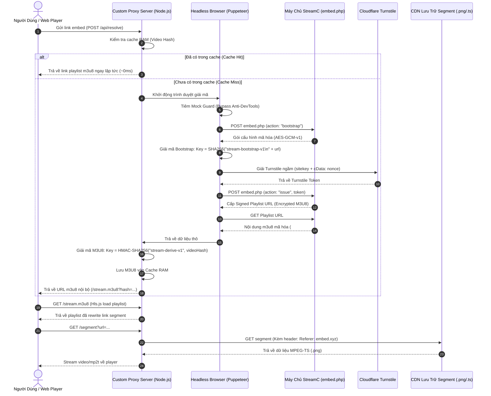

# Tài Liệu Kỹ Thuật: Quy Trình Bóc Tách & Giải Mã StreamC (embed.php)

> **Tài liệu phân tích Reverse Engineering & Giải thuật giải mã luồng video HLS từ các máy chủ Embed của StreamC (`embed11.streamc.xyz`, `embed13.streamc.xyz`,...)**

---

## 1. Sơ Đồ Tổng Quan Quy Trình (Architecture Workflow)



---

## 2. Chi Tiết Các Bước Kỹ Thuật

### Bước 1: Handshake Bootstrap (`action: "bootstrap"`)
Khi truy cập trang embed, client gửi request POST đầu tiên để xin cấp phiên:
* **Endpoint:** `https://embed<N>.streamc.xyz/embed.php?hash=<VIDEO_HASH>`
* **Method:** `POST`
* **Headers:**
  * `Content-Type: application/json`
  * `Referer: https://embed<N>.streamc.xyz/`
  * `Origin: https://embed<N>.streamc.xyz`
* **Body:**
  ```json
  {
    "action": "bootstrap",
    "referrer": "",
    "frame_origins": [],
    "request_grant": true,
    "playlist_format": "hls",
    "pretty_url": true,
    "path_chunks": true,
    "bootstrap_format": "aesgcm-v1"
  }
  ```

#### Giải thuật giải mã gói tin Bootstrap:
Server trả về JSON dạng:
```json
{
  "format": "aesgcm-v1",
  "iv": "652197a7e0c26afb9fb36cfb",
  "data": "Abt9vtB5bxg6DQxt0lHLJk..."
}
```
* **Thuật toán:** `AES-256-GCM`.
* **Dữ liệu xác thực (AAD):** `Buffer.from("stream-bootstrap-v1\n" + apiUrl)`
* **Khóa AES (Key):** `SHA-256(AAD)`
* **Vector khởi tạo (IV):** Hex decoded từ `response.iv` (12 bytes).
* **Tag:** 16 bytes cuối cùng của `Buffer.from(response.data, 'base64')`.
* **Ciphertext:** Phần còn lại của chuỗi base64.
* **Kết quả thu được:**
  * `bootstrap`: Chuỗi JWT token phiên khởi tạo.
  * `nonce`: Chuỗi ngẫu nhiên dùng để chống replay attack.
  * `turnstileSiteKey`: SiteKey của Cloudflare (ví dụ: `0x4AAAAAAEqJ2scJQpSPgNIm`).
  * `turnstileEnabled`: `true`.

---

### Bước 2: Vượt cơ chế kiểm tra Anti-DevTools (`guard-messages-r25.js`)
StreamC nhúng module bảo vệ `guard-messages-r25.js` để phát hiện bot và người mở F12:
1. **Kiểm tra độ trễ bẫy `debugger`:**
   ```javascript
   const e = performance.now(), t = performance.now();
   debugger;
   const n = performance.now();
   // Nếu có DevTools mở, lệnh debugger sẽ dừng chương trình khiến (n - t) tăng đột biến
   ```
2. **Kiểm tra kích thước cửa sổ:** Đo `outerWidth - innerWidth` (nếu lệch quá 260px nghĩa là có thanh công cụ DevTools bên cạnh).
3. **Thăm dò đối tượng Console:** Gọi `console.log(RegExp, Error)` và kiểm tra `toString` để phát hiện CDP (Chrome DevTools Protocol) của Puppeteer.

#### Giải pháp Bypass:
Chặn request tải file `guard-messages` trong Puppeteer và tiêm đối tượng giả lập hoàn hảo:
```javascript
window.streamGuard = {
    version: "guard-7",
    status: () => ({
        version: "guard-7",
        devtoolsBuild: "iframe-local-5",
        detectDevtools: true,
        blocked: false
    }),
    ready: Promise.resolve(),
    isBlocked: () => false,
    reportAdResource: () => {},
    waitForAccess: () => Promise.resolve(),
    registerPlayer: () => {}
};
```

---

### Bước 3: Giải Cloudflare Turnstile & Đổi Token Lấy Playlist (`action: "issue"`)

1. Trình duyệt tự động kích hoạt Cloudflare Turnstile ngầm với các tham số:
   * **SiteKey:** Lấy từ bootstrap (`0x4AAAAAA...`).
   * **Action:** `"playback"`.
   * **cData:** `nonce` nhận từ bootstrap.
2. Cloudflare sinh ra mã token: `cf-turnstile-response`.
3. Client gửi request thứ 2 lên server StreamC:
   * **Method:** `POST`
   * **Endpoint:** `https://embed<N>.streamc.xyz/embed.php?hash=<VIDEO_HASH>`
   * **Body:**
     ```json
     {
       "action": "issue",
       "bootstrap": "<bootstrap_jwt_token>",
       "turnstile_response": "<cf_turnstile_token>",
       "playlist_format": "aesgcm-v2",
       "pretty_url": true,
       "path_chunks": true
     }
     ```
4. Server trả về đường link playlist ký danh:
   ```json
   {
     "playlist": "https://embed<N>.streamc.xyz/eyJ0IjoiZXlKMGVYQWlPaUp3...",
     "playlistFormat": "aesgcm-v2",
     "issuedAt": 1793050000,
     "expiresAt": 1793136400
   }
   ```

---

### Bước 4: Tải & Giải Mã M3U8 Playlist Gốc

Khi gọi GET đến link playlist trên, server không trả về m3u8 thuần mà trả về một phong bì mã hóa:
```text
#EXTM3U
#ENC-AESGCM;iv=ca2eedbe444cc96d3c970147
#EXT-X-B65:0-138
qCpv5HTJVXfxtK2jxH3kS+c6OIWgxtIaM+LkBoL/7/wZVl+rqBrY9h101OhrNbnZvfEA...
```

#### Giải thuật giải mã M3U8:
1. **Dòng 1:** Tách IV bằng Regex: `/iv=([a-f0-9]+)/i` (12 bytes = 24 ký tự hex).
2. **Dòng 3:** Dữ liệu Base64:
   * 16 bytes cuối cùng: **Authentication Tag**.
   * Toàn bộ phần trước: **Ciphertext**.
3. **Sinh khóa giải mã (Key Derivation):**
   * Sử dụng thuật toán **HMAC-SHA256**:
     $$\text{Key} = \text{HMAC-SHA256}(\text{Secret} = \texttt{"stream-derive-v1"}, \text{Message} = \text{videoHash})$$
4. **Giải mã AES-GCM:**
   * Dùng `crypto.createDecipheriv('aes-256-gcm', key, iv)`.
   * Gán `setAuthTag(tag)`.
   * Kết quả `decipher.update() + decipher.final()` trả về nội dung **UTF-8 Playlist HLS chuẩn**.

Ví dụ nội dung m3u8 sau giải mã:
```m3u8
#EXTM3U
#EXT-X-VERSION:3
#EXT-X-TARGETDURATION:2
#EXT-X-MEDIA-SEQUENCE:0
#EXTINF:2.002000,
https://seouls11.amass11.top/816653d70e483b4f1cfe8eaf9dfe6d05/streamaaa0000.png
#EXTINF:2.002000,
https://seouls11.amass11.top/816653d70e483b4f1cfe8eaf9dfe6d05/streamaaa0001.png
...
```

---

### Bước 5: Proxy Segment & Xử Lý Anti-Hotlink CDN

1. **Bản chất file segment:**
   * Tên file kết thúc bằng `.png` nhưng các byte đầu tiên là `0x47 0x40 0x11 0x10...` (Magic byte `0x47` là định dạng **MPEG-TS** tiêu chuẩn của video HLS).
   * Video codec: **H.264 High Profile 1920x800**.
   * Audio codec: **AAC 48kHz Stereo**.
2. **Cơ chế chặn truy cập trái phép của CDN:**
   * Nếu trình duyệt tải trực tiếp link `https://.../streamaaa0000.png` $\rightarrow$ Bị chặn `403 Forbidden` do thiếu Referer hợp lệ hoặc dính lỗi CORS.
3. **Giải pháp Proxy:**
   * Server Node.js viết lại link segment trong m3u8 thành:
     `http://localhost:3333/segment?url=<ENCODED_URL>&origin=<EMBED_ORIGIN>`
   * Khi client yêu cầu segment, server gửi request kèm:
     `Referer: https://embed<N>.streamc.xyz/`
   * Bổ sung header trả về cho trình duyệt:
     `Access-Control-Allow-Origin: *`
     `Content-Type: video/mp2t`
   * Pipe luồng dữ liệu trực tiếp về player.

---

### Bước 6: Chiến Lược Cache RAM Tối Ưu (0ms Latency)

* Mỗi video hash chỉ cần giải mã Turnstile **1 lần duy nhất**.
* Nội dung M3U8 được lưu vào `Map` trong RAM (`streamCache`).
* Tất cả người xem tiếp theo yêu cầu cùng tập phim sẽ nhận playlist từ RAM trong vòng **dưới 1ms**, không tiêu tốn tài nguyên CPU và không bị Cloudflare gắn cờ IP.

---

## 3. Mã Nguồn Mẫu Độc Lập (Standalone Decryptor Script)

Dưới đây là đoạn code Node.js độc lập để giải mã playlist m3u8 từ chuỗi mã hóa:

```javascript
const crypto = require('crypto');

function decryptStreamcM3U8(rawEnvelopeText, videoHash) {
    const lines = rawEnvelopeText.trim().split('\n').map(l => l.trim());
    
    // 1. Lấy IV từ dòng 1 (#ENC-AESGCM;iv=...)
    const ivMatch = lines[1].match(/iv=([a-f0-9]+)/i);
    if (!ivMatch) throw new Error('Không tìm thấy IV hợp lệ');
    const iv = Buffer.from(ivMatch[1], 'hex');
    
    // 2. Tách Ciphertext và Auth Tag từ Base64 ở dòng 3
    const rawCipher = Buffer.from(lines[3], 'base64');
    const tag = rawCipher.subarray(rawCipher.length - 16);
    const ciphertext = rawCipher.subarray(0, rawCipher.length - 16);
    
    // 3. Sinh khóa AES từ videoHash qua HMAC-SHA256
    const hmac = crypto.createHmac('sha256', Buffer.from('stream-derive-v1', 'utf-8'));
    hmac.update(Buffer.from(videoHash, 'utf-8'));
    const aesKey = hmac.digest();
    
    // 4. Giải mã AES-256-GCM
    const decipher = crypto.createDecipheriv('aes-256-gcm', aesKey, iv);
    decipher.setAuthTag(tag);
    
    const decryptedM3U8 = Buffer.concat([
        decipher.update(ciphertext),
        decipher.final()
    ]).toString('utf-8');
    
    return decryptedM3U8;
}
```

---

## 4. Phân Tích Điểm Nghẽn Thường Gặp & Cách Khắc Phục (Troubleshooting & Pitfalls)

Khi kiểm thử bóc tách StreamC, nhiều hệ thống hoặc kiểm thử viên thường kết luận: *"Chỉ giải mã được Bootstrap, không lấy được Playlist M3U8"*. Dưới đây là phân tích chi tiết nguyên nhân gốc rễ và cách giải quyết:

### Điểm nghẽn 1: Thử gọi API `issue` "chay" mà không có Turnstile Token thật
* Nếu chỉ dùng script (curl / fetch / python requests) gửi POST lên server với `action: "issue"` mà để `turnstile_response: ""` (hoặc chuỗi giả), thì **chắc chắn 100% server sẽ trả về HTTP 403 `{"error": "verification_required"}`**.
* **Lý do:** Server backend của StreamC sẽ mang chuỗi token đó sang hỏi máy chủ Cloudflare (`https://challenges.cloudflare.com/turnstile/v0/siteverify`). Cloudflare báo token rỗng hoặc không hợp lệ $\rightarrow$ Server lập tức từ chối cấp playlist.

### Điểm nghẽn 2: Khi dùng trình duyệt tự động (Puppeteer/Selenium) lại bị dính "Bẫy kép Anti-DevTools"
Nhiều người sẽ nghĩ: *"Vậy thì bật Puppeteer/Selenium lên cho nó tự bấm/tự giải Turnstile rồi lấy playlist"*. Nhưng khi làm vậy **vẫn thất bại** vì bị dính tầng bảo vệ thứ 2:
1. Trang embed có nạp file script `guard-messages-r25.js`.
2. Script này âm thầm đặt bẫy:
   * Chạy lệnh `debugger;` ngầm và đo độ trễ `performance.now()`.
   * Ghi log đối tượng `RegExp` và `Error` vào console để xem có công cụ debug nào đang hook vào `console.log` không.
   * Đo độ lệch kích thước cửa sổ `outerWidth - innerWidth`.
3. Khi phát hiện đang chạy qua Puppeteer / WebDriver / CDP:
   * Biến cờ `streamGuard.isBlocked()` bị bật thành `true`.
   * Trong mã nguồn player, trước khi gọi Turnstile hay `issue()`, nó có dòng kiểm tra:
     ```javascript
     if (window.streamGuard?.isBlocked?.()) await window.streamGuard.waitForAccess();
     ```
   * Vì bị block, hàm `waitForAccess()` **bị treo vô hạn (không bao giờ resolve)** hoặc chuyển hướng sang web khác!
   * **Kết quả:** Không bao giờ lấy được playlist, khiến người kiểm thử tưởng rằng luồng này không thể giải mã được.

### Chìa khóa để thông toàn bộ luồng 100%:
Để đi tiếp từ bước Bootstrap đến lúc lấy được Playlist M3U8 và phát thành công video, bắt buộc phải thực hiện:

1. **Đánh chặn và vô hiệu hóa `guard-messages` (Bypass Guard):**
   * Trong Puppeteer, dùng `setRequestInterception(true)` chặn request tải `guard-messages-r25.js`, thay thế bằng 1 object giả lập nhẹ:
     ```javascript
     window.streamGuard = {
         version: "guard-7",
         status: () => ({ version: "guard-7", devtoolsBuild: "iframe-local-5", detectDevtools: true, blocked: false }),
         ready: Promise.resolve(),
         isBlocked: () => false,                // <-- Luôn báo không bị block!
         waitForAccess: () => Promise.resolve(), // <-- Cho phép đi tiếp ngay lập tức
         registerPlayer: () => {}
     };
     ```
2. **Để Cloudflare Turnstile tự giải ngầm:**
   * Khi `streamGuard` không còn chặn, widget Turnstile của Cloudflare chạy bình thường trong nền, tự vượt thử thách trong khoảng 1.5s và trả về chuỗi token thật `cf-turnstile-response`.
   * Script lập tức gửi token thật này lên `action: "issue"` $\rightarrow$ **Server StreamC chấp thuận và nhả Signed Playlist URL ngay lập tức!**
3. **Giải mã M3U8:**
   * Cầm Signed Playlist URL tải về nội dung `#ENC-AESGCM;iv=...` $\rightarrow$ Áp dụng công thức `HMAC-SHA256("stream-derive-v1", videoHash)` + `AES-256-GCM` $\rightarrow$ **Ra 100% danh sách segment video chuẩn và phát mượt mà trên trình duyệt.**

---

*Tài liệu được trích xuất và kiểm chứng thực nghiệm trực tiếp trên hệ thống Webproxy.*
